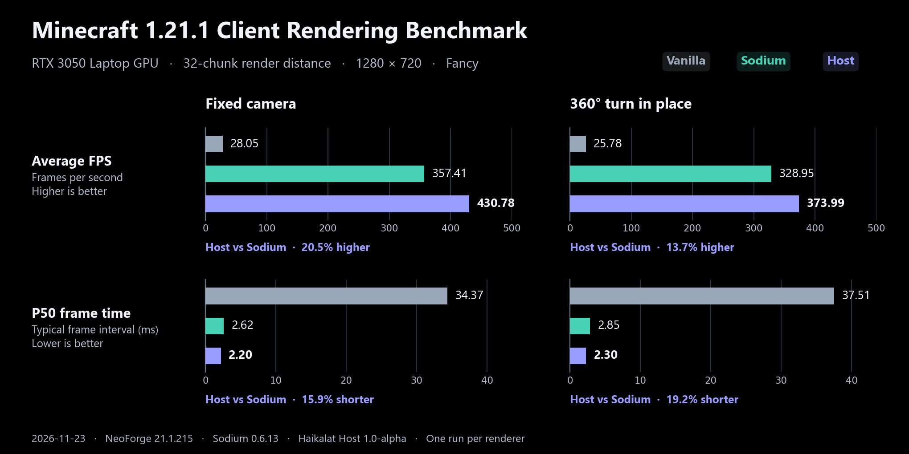

# Haikalat Host

English | [简体中文](README.zh-CN.md)

**1.0-alpha** · Minecraft **1.21.1** · NeoForge **21.1.215** · Java **21**

Haikalat Host is a client-side rendering optimization mod that brings Haikalat to Minecraft. It batches compatible terrain draws while using vanilla section meshes, visibility lists, and materials. This reduces the work the render thread spends uploading section offsets, binding buffers, and issuing draw calls. [Haikalat on GitHub](https://github.com/KLjiana/haikalat)

## Client benchmark

We benchmarked vanilla rendering, Sodium `0.6.13`, and Haikalat Host `1.0-alpha` in the same single-player world. We used a Core i7-12650H and an RTX 3050 Laptop GPU at 1280 × 720, with render and simulation distances set to 32 chunks. Each renderer ran once, with 17 seconds of sampling at a fixed camera position and 17 seconds during a full turn.

- **Average FPS** measures rendering throughput. It is the retained frame count divided by the total duration in seconds. Higher FPS means more frames produced per second.
- **P50 frame time** is the median frame interval in milliseconds. Roughly half of the measured intervals are at or below this value. A lower P50 means shorter typical frame intervals.

| Camera | Renderer | Average FPS ↑ | P50 frame time ↓ | P95 frame time ↓ | P99 frame time ↓ |
| --- | --- | ---: | ---: | ---: | ---: |
| Fixed | Vanilla | 28.05 | 34.37 ms | 42.52 ms | 52.64 ms |
| Fixed | Sodium | 357.41 | 2.62 ms | 4.30 ms | 5.29 ms |
| Fixed | Host | **430.78** | **2.20 ms** | **3.46 ms** | **4.31 ms** |
| Turning | Vanilla | 25.78 | 37.51 ms | 50.53 ms | 55.66 ms |
| Turning | Sodium | 328.95 | 2.85 ms | **4.93 ms** | **6.34 ms** |
| Turning | Host | **373.99** | **2.30 ms** | 5.26 ms | 7.82 ms |

Host had the highest average FPS and the shortest median frame time in both scenes. Sodium recorded shorter P95 and P99 frame times during the turn.

**P95** and **P99** are the 95th and 99th percentiles. About 5% and 1% of the measured frame intervals exceed those thresholds, respectively. Lower values are better for both.

We measured frame time between consecutive completed buffer swaps and excluded intervals that crossed a sampling boundary. Across both scenes, the render thread used **34.440 ms/frame** of CPU time for vanilla, **2.765 ms/frame** for Sodium, and **2.168 ms/frame** for Host.

Benchmark data and test settings are in `docs/benchmarks/2026-11-23/`.

## Rendering optimizations

- **Terrain batching.** Host uses MixinExtras to hook into vanilla's `solid`, `cutout_mipped`, `cutout`, and `translucent` layers. It submits compatible sections through multi-draw indirect with shared vertex and index buffers and reuses draw plans across frames. Eligible batches of small, byte-identical opaque meshes use a single instanced draw through Haikalat's `InstancedMeshBatch`.
- **Per-section fallback.** If a section cannot fit in the shared buffers, Host submits the preceding indirect batch, draws that section with the shared VAO, then continues batching. Translucent terrain keeps vanilla's section order and the sorted indices within each section. If a resource pack replaces a terrain shader, that layer uses vanilla submission.
- **Empty layers and off-screen clouds.** Host records which layers contain geometry when a section is compiled and builds each layer's draw list in vanilla visibility order. It skips cloud draws when the vanilla cloud mesh is entirely outside the view frustum.
- **Frame compositing.** Host runs Minecraft's scene and UI draws in Haikalat's RenderGraph, submits the game's post-processing passes, and presents the main render target to the screen.

## Terrain submission overhead

The off-screen benchmark draws 512 pre-baked terrain sections to a 640 × 360 framebuffer in a single OpenGL context. Each path warms up for 120 frames and measures 200 frames per round, with the path order rotating across four rounds. All three paths submit **16,384 triangles** per frame and pass RGBA and depth equality checks.

| Submission path | Submission wall time (ms/frame) ↓ | Time including batch completion (ms/frame) ↓ |
| --- | ---: | ---: |
| Vanilla per-section draws | 0.1643 | 0.1654 |
| Host per-section draws with a shared VAO | 0.1665 | 0.1673 |
| Host multi-draw indirect | **0.0366** | **0.0505** |

Multi-draw indirect reduced time including batch completion by about **69.5%** compared with vanilla in this scene. The shared-VAO path still issues a draw for each section and had similar overhead to vanilla. Timing starts after mesh upload. The submission column includes any time spent waiting in the driver. The completion column also includes the `glFinish` wait at the end of each measured batch.

Batching keeps GPU copies of the vanilla vertex buffers. The vertex arena grows on demand up to **256 MiB** by default, and the sorted-index arena has a **24 MiB** limit. Rebuilding, reusing, or unloading a section invalidates its copies. Host reclaims space from copies that go unused by batched draws for about two seconds. In two development runs with the same world and a 256 MiB vertex budget, no sections fell back with a fixed camera. During the turn, vertex arena fragmentation caused **4.02%–4.47%** of section draws to fall back, affecting **29.19%–34.74%** of batches.
