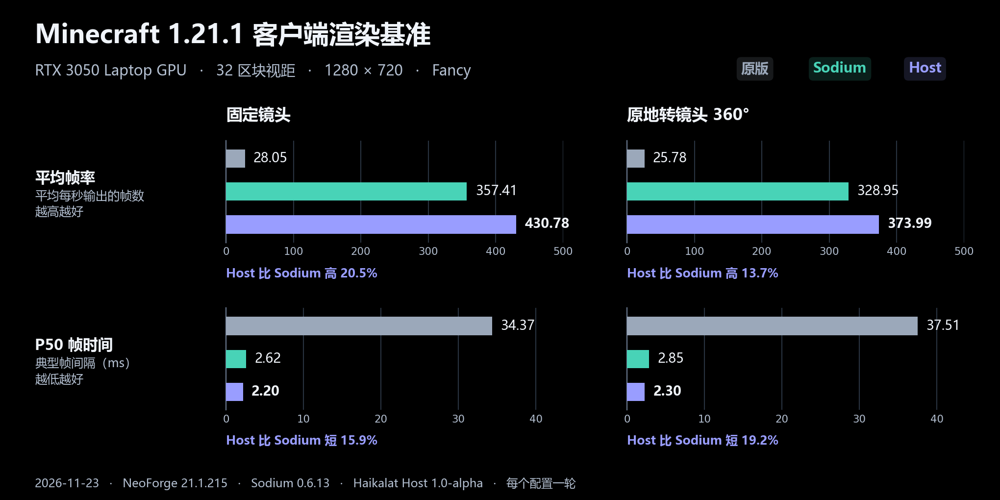

# Haikalat Host

[English](README.md) | 简体中文

**1.0-alpha** · Minecraft **1.21.1** · NeoForge **21.1.215** · Java **21**

Haikalat Host 是把 Haikalat 接入 Minecraft 客户端的渲染优化模组。它沿用原版的区段网格、可见列表和材质，把兼容的地形绘制合批，减少渲染线程逐区段上传偏移、绑定缓冲和发起绘制的开销。 [Haikalat 上游仓库](https://github.com/KLjiana/haikalat)

## 客户端实测

我们用同一份单人存档测试了原版渲染、Sodium `0.6.13` 和 Haikalat Host `1.0-alpha`。测试主机使用 Core i7-12650H 和 RTX 3050 Laptop GPU，分辨率为 1280 × 720，渲染距离和模拟距离均为 32 区块。每种渲染方案跑一轮，固定镜头和原地转一圈各采样 17 秒。

- **平均帧率（FPS）** 衡量整段采样的出帧速度，等于有效帧数除以采样时长（秒）。数值越高，每秒输出的帧越多。
- **P50 帧时间** 是帧间隔的中位数，单位为毫秒。约一半的帧间隔不超过这个值。P50 越低，典型的帧间隔越短。

| 镜头 | 渲染方案 | 平均 FPS ↑ | P50 帧时间 ↓ | P95 帧时间 ↓ | P99 帧时间 ↓ |
| --- | --- | ---: | ---: | ---: | ---: |
| 固定 | 原版 | 28.05 | 34.37 ms | 42.52 ms | 52.64 ms |
| 固定 | Sodium | 357.41 | 2.62 ms | 4.30 ms | 5.29 ms |
| 固定 | Host | **430.78** | **2.20 ms** | **3.46 ms** | **4.31 ms** |
| 转动 | 原版 | 25.78 | 37.51 ms | 50.53 ms | 55.66 ms |
| 转动 | Sodium | 328.95 | 2.85 ms | **4.93 ms** | **6.34 ms** |
| 转动 | Host | **373.99** | **2.30 ms** | 5.26 ms | 7.82 ms |

本轮固定和转动镜头下，Host 的平均帧率最高、中位帧时间最短。转镜头时，Sodium 的 P95 和 P99 更短。

**P95** 和 **P99** 分别是第 95 和第 99 百分位，约有 5% 和 1% 的帧间隔超过对应的值。两项都是越低越好。

帧时间取相邻两次窗口交换结束的间隔，剔除跨采样边界的帧。合并两个场景计算后，渲染线程的每帧 CPU 时间为原版 **34.440 ms**、Sodium **2.765 ms**、Host **2.168 ms**。

基准数据与测试设置见 `docs/benchmarks/2026-11-23/`。

## 渲染优化

- **地形合批**使用 MixinExtras 接入 `solid`、`cutout_mipped`、`cutout` 和 `translucent` 四个原版图层。兼容的区段通过共享顶点和索引缓冲执行间接多重绘制，提交计划可以跨帧复用。网格逐字节相同且满足条件的小型不透明批次可以交给 Haikalat 的 `InstancedMeshBatch` 一次绘制。
- **有序回退**在无法缓存某个区段时先提交前面的间接批次，再以共享 VAO 绘制该区段，然后接上剩余批次。半透明继续沿用原版区段顺序和区段内排序索引。资源包替换地形着色器时走原版提交。
- **跳过空图层和视锥外的云**。Host 在编译阶段记录区段的非空图层，每帧按原版可见顺序构建逐层列表。原版云网格完全离开视锥时跳过提交。
- **帧合成**在 Haikalat RenderGraph 中执行 Minecraft 的场景和 UI 绘制，接管原版后处理的提交和主目标的全屏呈现。

## 地形提交开销

离屏基准在同一个 OpenGL 上下文中，将 512 个预烘焙地形区段渲染到 640 × 360 的帧缓冲区。每条路径预热 120 帧，每轮采样 200 帧，四轮测试轮换执行顺序。三条路径每帧均提交 **16,384 个三角形**，RGBA 和深度一致性校验均通过。

| 提交路径 | 提交墙钟 ms/帧 ↓ | 等待批次完成后 ms/帧 ↓ |
| --- | ---: | ---: |
| 原版逐区段绘制 | 0.1643 | 0.1654 |
| Host 共享 VAO 逐区段绘制 | 0.1665 | 0.1673 |
| Host 间接多重绘制 | **0.0366** | **0.0505** |

本场景中，间接多重绘制把等待完成后的耗时降低约 **69.5%**。共享 VAO 路径仍逐区段绘制，耗时与原版接近。计时在网格上传后开始，提交时间包含驱动等待，完成时间在每批末用 `glFinish` 计入 GPU 完成。

场景中的批处理要维护原版 VBO 的 GPU 副本。默认顶点缓存按需增长到 **256 MiB**，排序索引缓存上限 **24 MiB**。网格重建、区段重用和卸载会使旧副本失效，约两秒未参与批量提交的副本会释放缓存空间。两次开发期诊断使用同一存档和 256 MiB 顶点预算。固定镜头阶段的区段绘制回退率为零。转动阶段有 **4.02%–4.47%** 的区段绘制因顶点缓存碎片回退，涉及 **29.19%–34.74%** 的批次。
